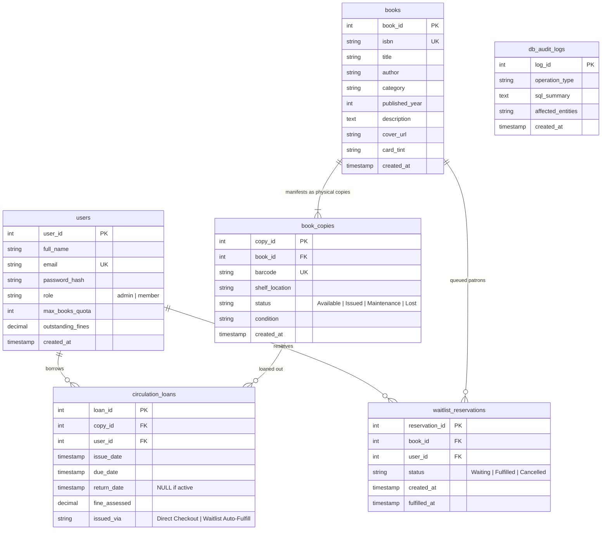

# 📚 BookBase — B.Tech CSBS Curriculum Library & Book Bank

A production-grade Smart Library Management System & Academic Book Bank tailored for the **5-Year Integrated B.Tech in Computer Science and Business Systems (CSBS)** curriculum.

Features prescribed curriculum textbooks paired with corresponding **O'Reilly Professional Editions**, real-time physical inventory tracking, automated waitlist reservations, and genuine library circulation desk workflows.

---

## 🏛️ Academic Program Overview & Curriculum Alignment
- **Program:** 5-Year Integrated B.Tech in Computer Science and Business Systems (CSBS)
- **Curriculum Framework:** Business 4.0 Academic Standard (AICTE & TCS CSBS Framework)
- **Library Hours:** Monday – Friday: 8:00 AM – 8:00 PM | Saturday – Sunday: 9:00 AM – 5:30 PM
- **Contact:** `library.desk@bookbase.in` | Tel: +91 80 2345 6789 | Digital Central Library Desk

---

## 🌟 Key Architecture Highlights

1. **Strict 3NF Normalization:**
   - Physical inventory (`book_copies`) is strictly decoupled from abstract intellectual property (`books`).
   - Dynamic Availability: Availability count is **never stored as a static column**; it is dynamically computed in real-time from `COUNT(copy_id) WHERE status = 'Available'`, preventing anomalies and race conditions.
2. **ACID Concurrency & Row-Level Locking:**
   - Atomic checkout uses `SELECT copy_id FROM book_copies WHERE book_id = :id AND status = 'Available' LIMIT 1 FOR UPDATE` to prevent double-booking under concurrent load.
   - Storage-engine level uniqueness guarantee:
     ```sql
     CREATE UNIQUE INDEX idx_single_active_loan_per_copy 
     ON circulation_loans(copy_id) 
     WHERE return_date IS NULL;
     ```
3. **Automated Reservation Promotion on Return:**
   - When any patron returns a book (`POST /api/v1/circulation/return`), the backend transaction checks `waitlist_reservations` for the oldest waiting student (`ORDER BY created_at ASC, reservation_id ASC LIMIT 1`).
   - If a waiting student exists, the copy is atomically assigned to the #1 waitlisted student (`issued_via = 'Waitlist Auto-Fulfill'`).
   - The waitlist entry is marked `Fulfilled`, and the remaining queue positions auto-reindex.
4. **Authentic Authentication & User Sessions:**
   - Real-world login for Central Librarian and B.Tech CSBS Students:
     - **Library Staff:** `admin@bookbase.in` (password: `admin123`)
     - **Student Patrons:**
       - `tejas@bookbase.in` (password: `member123`)
       - `akash@bookbase.in` (password: `member123`)
       - `saikartikeya@bookbase.in` (password: `member123`)
       - `biba@bookbase.in` (password: `member123`)
       - `jaidanya@bookbase.in` (password: `member123`)

---

## 📖 B.Tech CSBS Prescribed Textbooks & O'Reilly Counterparts

Every subject module in the 5-Year Integrated CSBS curriculum is paired with a corresponding O'Reilly industry standard reference:

| # | Subject Area | Prescribed Syllabus Textbook | O'Reilly Professional Alternative |
| :-: | :--- | :--- | :--- |
| 1 | **Discrete Mathematics** | *Discrete Mathematical Structures* (Tremblay & Manohar) | *Mastering Algorithms with C* (Kyle Loudon) |
| 2 | **Algorithms & Data Structures** | *Introduction to Algorithms (CLRS)* (Cormen et al.) | *Algorithms in a Nutshell* (George Heineman et al.) |
| 3 | **Object-Oriented Programming** | *Java: The Complete Reference* (Herbert Schildt) | *Head First Java: A Brain-Friendly Guide* (Kathy Sierra et al.) |
| 4 | **Computer Architecture** | *Computer Organization and Design* (Patterson & Hennessy) | *Designing Embedded Hardware* (John Catsoulis) |
| 5 | **Automata & Formal Languages** | *Introduction to Automata Theory* (Hopcroft, Motwani, Ullman) | *Mastering Regular Expressions* (Jeffrey Friedl) |
| 6 | **Operating Systems** | *Operating System Concepts* (Silberschatz, Galvin, Gagne) | *Linux System Programming* (Robert Love) |
| 7 | **Database Management Systems** | *Database System Concepts* (Silberschatz, Korth, Sudarshan) | *Designing Data-Intensive Applications* (Martin Kleppmann) |
| 8 | **Software Engineering** | *Software Engineering: A Practitioner's Approach* (Pressman) | *Software Engineering at Google* (Winters et al.) |
| 9 | **Computer Networks** | *Computer Networks* (Tanenbaum & Wetherall) | *High Performance Browser Networking* (Ilya Grigorik) |
| 10 | **Compiler Design** | *Compilers: Principles, Techniques, and Tools* (Dragon Book) | *flex & bison: Text Processing Tools* (John Levine) |
| 11 | **Principles of Management** | *Principles of Management* (P.C. Tripathi, P.N. Reddy) | *The Manager's Path* (Camille Fournier) |
| 12 | **Financial Management** | *Financial Management: Theory & Practice* (Prasanna Chandra) | *Python for Finance* (Yves Hilpisch) |
| 13 | **Business Strategy** | *Contemporary Strategy Analysis* (Robert M. Grant) | *Technology Strategy Patterns* (Eben Hewitt) |
| 14 | **Design Thinking & Innovation** | *The Design of Business* (Roger L. Martin, Harvard) | *Designing Interfaces: Patterns for Interaction* (Tidwell) |
| 15 | **Data Mining & Analytics** | *Data Mining: Concepts and Techniques* (Han, Kamber, Pei) | *Python for Data Analysis* (Wes McKinney) |
| 16 | **Machine Learning & AI** | *Pattern Recognition and Machine Learning* (Bishop) | *Hands-On Machine Learning with Scikit-Learn* (Géron) |
| 17 | **Information Security** | *Cryptography and Network Security* (William Stallings) | *Network Security Assessment* (Chris McNab) |
| 18 | **Cloud Computing** | *Cloud Computing: Principles and Paradigms* (Buyya et al.) | *Kubernetes: Up and Running* (Burns, Beda, Hightower) |
| 19 | **Banking Tech & FinTech** | *Principles and Practices of Banking* (IIBF official text) | *Mastering Bitcoin: The Open Blockchain* (Antonopoulos) |
| 20 | **Operations Research** | *Operations Research: An Introduction* (Hamdy A. Taha) | *Data Science for Business* (Provost & Fawcett) |

---

## 🗄️ 3NF Relational Database Schema



---

## 🚀 Quick Start (Runs in 1 Minute)

### Local Launch (FastAPI + React)

```bash
# 1. Run the system
./start.sh
# or:
python3 run.py
```

- **Web Application UI:** [http://127.0.0.1:8001](http://127.0.0.1:8001)
- **FastAPI Interactive Swagger Docs:** [http://127.0.0.1:8001/docs](http://127.0.0.1:8001/docs)

### Configuration

| Environment variable | When | What it does |
| :--- | :--- | :--- |
| `BOOKBASE_SECRET_KEY` | **Required on Vercel** | Signs session tokens, and must be at least 32 characters. The API refuses to start on Vercel without it. `run.py` generates one for each run, so local sessions end when you restart it. |
| `BOOKBASE_DEMO_MODE` | Optional | `1` lists the seeded accounts and their passwords in the sign-in modal. `run.py` turns this on. Everywhere else it is off unless you set it. |
| `BOOKBASE_TOKEN_TTL_MINUTES` | Optional | How long a session lasts. Defaults to 480 (8 hours). |
| `BOOKBASE_CORS_ORIGINS` | Optional | Comma-separated origins allowed to call the API from another site. Defaults to the Vite dev server. The deployed frontend shares the API's origin, so it needs nothing here. |

Generate a signing key with:

```bash
python3 -c "import secrets; print(secrets.token_urlsafe(48))"
```

### Running the Tests

```bash
cd backend
pip install -r requirements-dev.txt
python -m pytest
```

---

## 🗂️ Project Structure

```text
BookBase/
├── api/index.py               # Vercel serverless entry point (wraps the FastAPI app)
├── backend/
│   ├── bookbase.db            # Pre-seeded SQLite database
│   ├── tests/                 # Permission, token and password tests
│   └── app/
│       ├── main.py            # FastAPI app: middleware, error handling, router registration
│       ├── config.py          # Database location and lending policy (loan length, fines, quotas)
│       ├── routers/           # HTTP layer only: each route validates input and calls one service
│       ├── services/          # Business logic: checkout, FIFO waitlist, fines, dashboards
│       ├── schemas/           # Pydantic request/response models, one file per domain
│       ├── db/                # Connections, transactions, schema, shared SQL, audit log, seed data
│       └── core/              # Cross-cutting helpers: errors, clock, password hashing, session tokens, auth dependencies
├── frontend/src/
│   ├── App.jsx                # Composes the hooks, views and modals
│   ├── api/                   # BookBase REST client and OpenLibrary lookup
│   ├── hooks/                 # App-wide state: session, catalog, circulation actions, toasts
│   ├── constants/             # Book categories and portal metadata
│   ├── components/            # Shared UI: layout (navbar, footer), ui (tabs, toast), books (cover)
│   └── features/              # One folder per area: admin, auth, catalog, requests, shelf
└── database/schema_postgres.sql   # PostgreSQL schema (the app itself runs on SQLite)
```

### Where new code goes

| To add or change... | Look in |
| :--- | :--- |
| An API endpoint | Route in `routers/`, logic in `services/`, models in `schemas/` |
| Who may call an endpoint | `get_current_user` or `require_admin` from `core/auth.py`. A test fails for any route that accepts anonymous callers unless it is listed in `PUBLIC_ROUTES` in `tests/test_permissions.py` |
| A lending rule (fine rate, quota, loan length) | `config.py`, then `services/circulation_service.py` |
| An API error | Raise a class from `core/errors.py` in a service; `main.py` turns it into the HTTP response |
| SQL used by more than one service | `db/queries.py` (SQL used once stays in its service) |
| A tab in the librarian or student view | `features/admin/tabs/` or `features/shelf/tabs/`, registered in that area's view |

Tabs unmount when you switch away from them, so state that must survive a tab switch (such as the matrix search) belongs in the parent view or its hook, not in the tab. Avoid naming a folder `lib/`, `build/` or `dist/`: `.gitignore` excludes them at any depth.

---

## 👥 Seeded User Accounts (`@bookbase.in`)

These passwords are public demo credentials, and they work on any deployment that uses the committed `bookbase.db`, whether or not demo mode is on.

| Persona | Role | Email | Password | Pre-Seeded State |
| :--- | :--- | :--- | :--- | :--- |
| **Admin** | Admin | `admin@bookbase.in` | `admin123` | Full circulation desk & inventory management |
| **Tejas** | Member | `tejas@bookbase.in` | `member123` | Borrowed DDIA & CLRS (CLRS overdue) |
| **Akash** | Member | `akash@bookbase.in` | `member123` | Queue #1 on CLRS |
| **Sai Kartikeya** | Member | `saikartikeya@bookbase.in` | `member123` | Clean account ready to borrow / reserve |
| **Biba** | Member | `biba@bookbase.in` | `member123` | Clean account ready to borrow / reserve |
| **Jaidanya** | Member | `jaidanya@bookbase.in` | `member123` | Clean account ready to borrow / reserve |

---

## 📡 REST API Reference

All frontend operations strictly communicate through these endpoints. Each one is also served under `/v1`, with the same rules.

Sign in with `POST /api/v1/auth/login`, then send the token it returns as `Authorization: Bearer <token>`. Tokens are signed and expire after 8 hours by default.

| Access | Who can call it |
| :--- | :--- |
| **Public** | Anyone, with no token |
| **Signed in** | Any valid token. The route acts on the caller's own account |
| **Owner or admin** | A member acting on their own data, or an admin acting on anyone's |
| **Admin** | Librarian accounts only |

- **401** means there is no token, or the token is invalid or expired. A token that is sent must be valid, even on a public route.
- **403** means the token is fine, but the caller's role or account doesn't allow this action.
- Where a body or query takes an optional `user_id`, leaving it out means the caller. A member who passes someone else's id gets 403. An admin can use it to act for a patron.

### Authentication & Profiles

| Route | Access | Purpose |
| :--- | :--- | :--- |
| `POST /api/v1/auth/login` | Public | Authenticate and receive a session token |
| `POST /api/v1/auth/register` | Public | Create a student account and receive a session token |
| `GET /api/v1/auth/demo-users` | Public | Seeded accounts for the sign-in modal. Empty unless `BOOKBASE_DEMO_MODE` is on |
| `GET /api/v1/auth/me` | Signed in | The caller's profile, quota and fine status |

### Catalog & 3NF Inventory

| Route | Access | Purpose |
| :--- | :--- | :--- |
| `GET /api/v1/books?search=&category=&availability=&user_id=` | Public | Multi-table aggregated search & availability. A signed-in caller also gets their own loan and waitlist context. Only admins see who holds each copy, or can pass `user_id` |
| `GET /api/v1/books/{book_id}?user_id=` | Public | Full book specifications, copies table and FIFO queue lineup, with the same rules |
| `POST /api/v1/books` | Admin | Register title + initial barcoded copies |
| `POST /api/v1/books/{book_id}/copies` | Admin | Add individual barcoded physical copy |

`waitlist_entries[]` on book detail lists `reservation_id`, `queue_position`, `created_at`, `user_id` and `user_name` in queue order. `user_id` and `user_name` are only set for admins and for the caller's own entry, and email and enrollment number are never included. `GET /books` does not include it.

### Circulation & Waitlist Mechanics

| Route | Access | Purpose |
| :--- | :--- | :--- |
| `POST /api/v1/circulation/checkout` | Owner or admin | Atomic loan checkout with row-level locking |
| `POST /api/v1/circulation/waitlist` | Owner or admin | Atomic FIFO queue registration |
| `DELETE /api/v1/circulation/waitlist/{id}` | Owner or admin | Cancel waiting reservation |
| `POST /api/v1/circulation/return` | Owner or admin | Return processing with overdue fine calculation & automated FIFO waitlist handoff |
| `GET /api/v1/policy` | Public | The lending rules from `config.py`: `overdue_fine_rate_per_day`, `loan_duration_days` and `max_loans_per_user`. The footer shows them before sign-in. `max_loans_per_user` is the quota new accounts get; checkout enforces each account's stored `max_books_quota`, so changing it does not affect existing accounts |

### Student Book Requests

| Route | Access | Purpose |
| :--- | :--- | :--- |
| `GET /api/v1/requests?user_id=` | Signed in | Members get their own requests. Admins get everyone's, or one patron's with `user_id` |
| `POST /api/v1/requests` | Owner or admin | Submit a book acquisition request |
| `PATCH /api/v1/requests/{request_id}` | Admin | Approve, procure or reject a request |

### Dashboards & Admin

| Route | Access | Purpose |
| :--- | :--- | :--- |
| `GET /api/v1/users/{user_id}/dashboard` | Owner or admin | Active loans, countdowns, waitlist cards, borrowing history |
| `GET /api/v1/admin/overview` | Admin | Library KPIs, circulation desk table, global waitlist lineup, student fines ledger |
| `GET /api/v1/admin/grouped-books?search=` | Admin | Curriculum titles with their borrower history |
| `POST /api/v1/admin/settle-fine` | Admin | Record a fine payment. Send `user_id` and optionally `amount_settled`; leaving it out settles the full balance. An amount above the balance is capped at the balance. Returns `400` if the amount is zero or negative |
| `POST /api/v1/admin/reset-demo` | Admin | 1-click database reset to initial demo state. Ends every other session and returns a new token for the caller |
| `GET /api/v1/telemetry/logs` | Admin | DBMS audit log, which names patrons and what they borrowed |
| `GET /api/v1/health` | Public | Health check |

- `student_fines[]` in the overview: `user_id`, `full_name`, `enrollment_no`, `email`, `outstanding_fines`, highest balance first. Lists every student, plus any other account with a balance, so it adds up to `kpis.total_fines`.
- `waitlist_queue[].user_enrollment_no` in the overview: the waiting patron's enrollment number.
- `waitlist_count` on grouped books, and on `grouped_books[]` in the overview: patrons waiting for the title.

### Fine fields on loans
Loans in the dashboard and overview, and `borrowers[]` in the grouped books, carry `accrued_fine`. On a loan still out it is what returning the copy now would charge, using the daily rate in `config.py`; on a returned loan it is what was charged. Loans also carry `days_overdue`, the days that fine is based on. A fine only adds to `outstanding_fines` when the copy is returned, so an overdue loan still out does not appear in `student_fines`.
