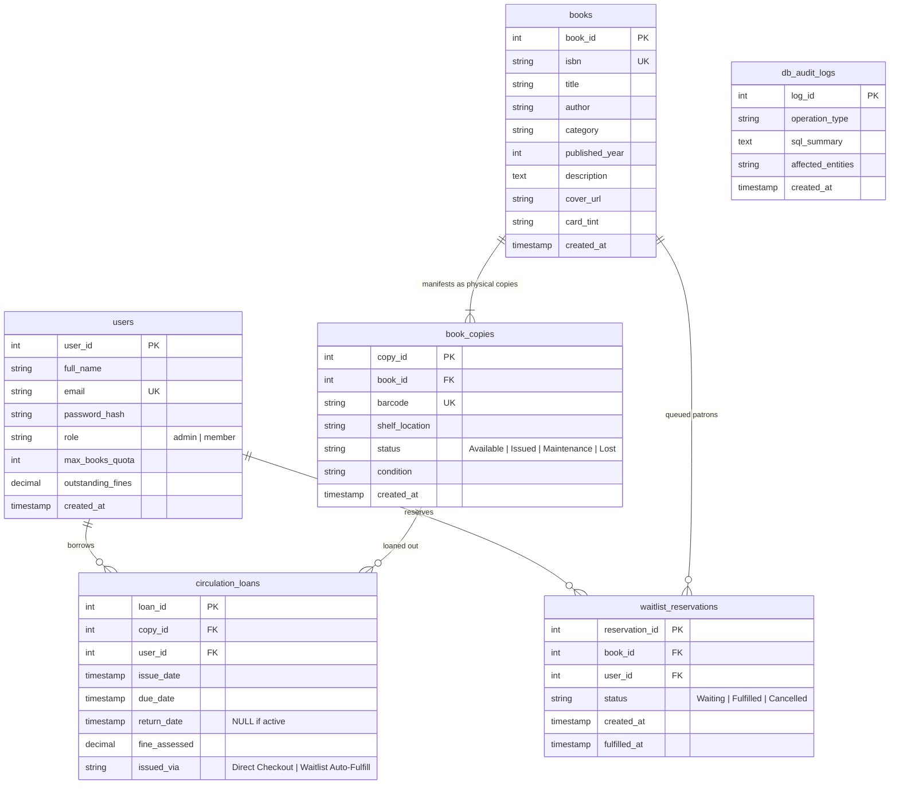

# 📚 BookBase — B.Tech CSBS Curriculum Library & Book Bank

A production-grade Smart Library Management System & Academic Book Bank tailored for the **5-Year Integrated B.Tech in Computer Science and Business Systems (CSBS)** curriculum.

Features prescribed curriculum textbooks paired with corresponding **O'Reilly Professional Editions**, real-time physical inventory tracking, automated waitlist reservations, and genuine library circulation desk workflows.

---

## 🏛️ Academic Program Overview & Curriculum Alignment
- **Program:** 5-Year Integrated B.Tech in Computer Science and Business Systems (CSBS)
- **Curriculum Framework:** Business 4.0 Academic Standard (AICTE & TCS CSBS Framework)
- **Library Hours:** Monday – Friday: 8:00 AM – 8:00 PM | Saturday – Sunday: 9:00 AM – 5:30 PM
- **Contact:** `library.desk@bookbase.in` | Tel: +91 80 2345 6789 | Digital Central Library Desk

---

## 🌟 Key Architecture Highlights

1. **Strict 3NF Normalization:**
   - Physical inventory (`book_copies`) is strictly decoupled from abstract intellectual property (`books`).
   - Dynamic Availability: Availability count is **never stored as a static column**; it is dynamically computed in real-time from `COUNT(copy_id) WHERE status = 'Available'`, preventing anomalies and race conditions.
2. **ACID Concurrency & Row-Level Locking:**
   - Atomic checkout uses `SELECT copy_id FROM book_copies WHERE book_id = :id AND status = 'Available' LIMIT 1 FOR UPDATE` to prevent double-booking under concurrent load.
   - Storage-engine level uniqueness guarantee:
     ```sql
     CREATE UNIQUE INDEX idx_single_active_loan_per_copy 
     ON circulation_loans(copy_id) 
     WHERE return_date IS NULL;
     ```
3. **Automated Reservation Promotion on Return:**
   - When any patron returns a book (`POST /api/v1/circulation/return`), the backend transaction checks `waitlist_reservations` for the oldest waiting student (`ORDER BY created_at ASC, reservation_id ASC LIMIT 1`).
   - If a waiting student exists, the copy is atomically assigned to the #1 waitlisted student (`issued_via = 'Waitlist Auto-Fulfill'`).
   - The waitlist entry is marked `Fulfilled`, and the remaining queue positions auto-reindex.
4. **Authentic Authentication & User Sessions:**
   - Real-world login for Central Librarian and B.Tech CSBS Students:
     - **Library Staff:** `admin@bookbase.in` (password: `admin123`)
     - **Student Patrons:**
       - `tejas@bookbase.in` (password: `member123`)
       - `akash@bookbase.in` (password: `member123`)
       - `saikartikeya@bookbase.in` (password: `member123`)
       - `biba@bookbase.in` (password: `member123`)
       - `jaidanya@bookbase.in` (password: `member123`)

---

## 📖 B.Tech CSBS Prescribed Textbooks & O'Reilly Counterparts

Every subject module in the 5-Year Integrated CSBS curriculum is paired with a corresponding O'Reilly industry standard reference:

| # | Subject Area | Prescribed Syllabus Textbook | O'Reilly Professional Alternative |
| :-: | :--- | :--- | :--- |
| 1 | **Discrete Mathematics** | *Discrete Mathematical Structures* (Tremblay & Manohar) | *Mastering Algorithms with C* (Kyle Loudon) |
| 2 | **Algorithms & Data Structures** | *Introduction to Algorithms (CLRS)* (Cormen et al.) | *Algorithms in a Nutshell* (George Heineman et al.) |
| 3 | **Object-Oriented Programming** | *Java: The Complete Reference* (Herbert Schildt) | *Head First Java: A Brain-Friendly Guide* (Kathy Sierra et al.) |
| 4 | **Computer Architecture** | *Computer Organization and Design* (Patterson & Hennessy) | *Designing Embedded Hardware* (John Catsoulis) |
| 5 | **Automata & Formal Languages** | *Introduction to Automata Theory* (Hopcroft, Motwani, Ullman) | *Mastering Regular Expressions* (Jeffrey Friedl) |
| 6 | **Operating Systems** | *Operating System Concepts* (Silberschatz, Galvin, Gagne) | *Linux System Programming* (Robert Love) |
| 7 | **Database Management Systems** | *Database System Concepts* (Silberschatz, Korth, Sudarshan) | *Designing Data-Intensive Applications* (Martin Kleppmann) |
| 8 | **Software Engineering** | *Software Engineering: A Practitioner's Approach* (Pressman) | *Software Engineering at Google* (Winters et al.) |
| 9 | **Computer Networks** | *Computer Networks* (Tanenbaum & Wetherall) | *High Performance Browser Networking* (Ilya Grigorik) |
| 10 | **Compiler Design** | *Compilers: Principles, Techniques, and Tools* (Dragon Book) | *flex & bison: Text Processing Tools* (John Levine) |
| 11 | **Principles of Management** | *Principles of Management* (P.C. Tripathi, P.N. Reddy) | *The Manager's Path* (Camille Fournier) |
| 12 | **Financial Management** | *Financial Management: Theory & Practice* (Prasanna Chandra) | *Python for Finance* (Yves Hilpisch) |
| 13 | **Business Strategy** | *Contemporary Strategy Analysis* (Robert M. Grant) | *Technology Strategy Patterns* (Eben Hewitt) |
| 14 | **Design Thinking & Innovation** | *The Design of Business* (Roger L. Martin, Harvard) | *Designing Interfaces: Patterns for Interaction* (Tidwell) |
| 15 | **Data Mining & Analytics** | *Data Mining: Concepts and Techniques* (Han, Kamber, Pei) | *Python for Data Analysis* (Wes McKinney) |
| 16 | **Machine Learning & AI** | *Pattern Recognition and Machine Learning* (Bishop) | *Hands-On Machine Learning with Scikit-Learn* (Géron) |
| 17 | **Information Security** | *Cryptography and Network Security* (William Stallings) | *Network Security Assessment* (Chris McNab) |
| 18 | **Cloud Computing** | *Cloud Computing: Principles and Paradigms* (Buyya et al.) | *Kubernetes: Up and Running* (Burns, Beda, Hightower) |
| 19 | **Banking Tech & FinTech** | *Principles and Practices of Banking* (IIBF official text) | *Mastering Bitcoin: The Open Blockchain* (Antonopoulos) |
| 20 | **Operations Research** | *Operations Research: An Introduction* (Hamdy A. Taha) | *Data Science for Business* (Provost & Fawcett) |

---

## 🗄️ 3NF Relational Database Schema



---

## 🚀 Quick Start (Runs in 1 Minute)

### Local Launch (FastAPI + React)

```bash
# 1. Run the system
./start.sh
# or:
python3 run.py
```

- **Web Application UI:** [http://127.0.0.1:8001](http://127.0.0.1:8001)
- **FastAPI Interactive Swagger Docs:** [http://127.0.0.1:8001/docs](http://127.0.0.1:8001/docs)

---

## 👥 Seeded User Accounts (`@bookbase.in`)

| Persona | Role | Email | Password | Pre-Seeded State |
| :--- | :--- | :--- | :--- | :--- |
| **Admin** | Admin | `admin@bookbase.in` | `admin123` | Full circulation desk & inventory management |
| **Tejas** | Member | `tejas@bookbase.in` | `member123` | Borrowed DDIA & CLRS (CLRS overdue) |
| **Akash** | Member | `akash@bookbase.in` | `member123` | Queue #1 on CLRS |
| **Sai Kartikeya** | Member | `saikartikeya@bookbase.in` | `member123` | Clean account ready to borrow / reserve |
| **Biba** | Member | `biba@bookbase.in` | `member123` | Clean account ready to borrow / reserve |
| **Jaidanya** | Member | `jaidanya@bookbase.in` | `member123` | Clean account ready to borrow / reserve |

---

## 📡 REST API Reference

All frontend operations strictly communicate through these endpoints:

### Authentication & Profiles
- `POST /api/v1/auth/login` — Authenticate and receive session token
- `GET /api/v1/auth/demo-users` — Retrieve seeded accounts for testing
- `GET /api/v1/auth/me?user_id={id}` — Current user quota and fine status

### Catalog & 3NF Inventory
- `GET /api/v1/books?search=&category=&availability=&user_id=` — Multi-table aggregated search & availability
- `GET /api/v1/books/{book_id}?user_id=` — Full book specifications, copies table, and FIFO queue lineup
- `POST /api/v1/books` — Register title + initial barcoded copies (*Admin*)
- `POST /api/v1/books/{book_id}/copies` — Add individual barcoded physical copy (*Admin*)

### Circulation & Waitlist Mechanics
- `POST /api/v1/circulation/checkout` — Atomic loan checkout with row-level locking
- `POST /api/v1/circulation/waitlist` — Atomic FIFO queue registration
- `DELETE /api/v1/circulation/waitlist/{id}` — Cancel waiting reservation
- `POST /api/v1/circulation/return` — Return processing with overdue fine calculation & automated FIFO waitlist handoff

### Dashboards & Admin
- `GET /api/v1/users/{user_id}/dashboard` — Active loans, countdowns, waitlist cards, borrowing history
- `GET /api/v1/admin/overview` — Library KPIs, circulation desk table, global waitlist lineup
- `POST /api/v1/admin/reset-demo` — 1-click database reset to initial demo state
