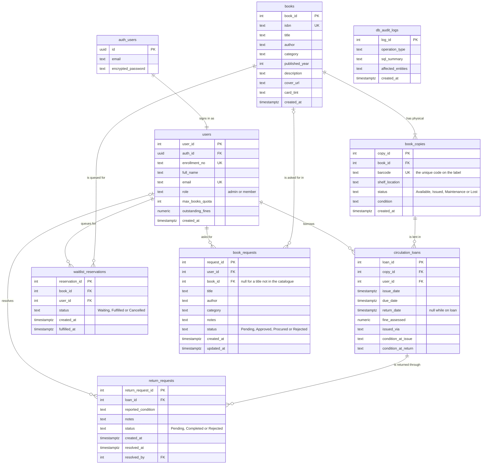

# BookBase ER diagram

This matches `supabase/schema.sql`. GitHub draws the diagram below. On Supabase, **Database → Schema Visualizer** draws the same relationships from the live tables.

`auth_users` is Supabase Auth's own `auth.users` table, which keeps every email and password. Each `users` row is one login's library account, linked by `auth_id`, so BookBase never stores a password itself.

`db_audit_logs` has no foreign keys on purpose: it is an append-only history, and it must outlive whatever it describes.

## Rules the database enforces

| Rule | How |
| :--- | :--- |
| A copy can be on only one active loan | Partial unique index `idx_single_active_loan_per_copy` on `copy_id` where `return_date IS NULL` |
| A loan can have only one pending return request | Partial unique index `idx_single_pending_return_per_loan` on `loan_id` where `status = 'Pending'` |
| A student can hold only one waiting spot per title | Partial unique index `idx_unique_active_waitlist_per_user` on `(book_id, user_id)` where `status = 'Waiting'` |
| Each copy has one unique code | `UNIQUE` on `book_copies.barcode` |
| Each login has exactly one library account | `UNIQUE` on `users.auth_id` |
| A copy with loan history can't be deleted, and nor can a student with one | `ON DELETE RESTRICT` on `circulation_loans.copy_id` and `user_id` |
| Fines and quotas stay sensible | `CHECK (outstanding_fines >= 0)`, `CHECK (max_books_quota > 0)`, `CHECK (fine_assessed >= 0)` |
| Status and role columns hold only known values | `CHECK (status IN (...))`, `CHECK (role IN ('admin', 'member'))` |

## Normalisation

- **3NF:** a book's available count isn't stored. It is derived from `book_copies`. A return request stores its loan and not the borrower, because the borrower follows from the loan.
- **Known exception to 1NF:** `books.author` holds co-authors as one comma-separated string.
